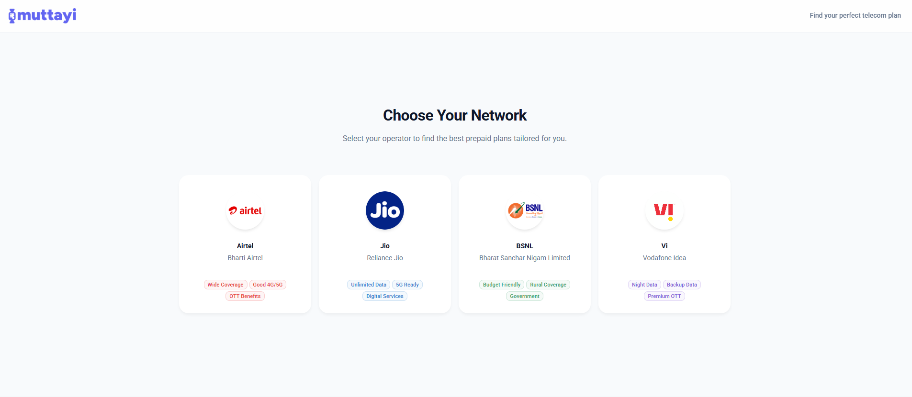

# Muttayi — Compare Mobile Recharge Plans

**[muttayi.com](https://muttayi.com)** helps you find the best prepaid recharge plan in India across **Airtel, Jio, BSNL and Vi**. Filter by data, calls, SMS, 5G and OTT subscriptions, then sort by price, cost per day or cost per GB.

Free. No ads. No sign-up.



## Found a wrong plan? Want a feature?

| I want to… | Do this |
| --- | --- |
| Report wrong plan details | Click **Report** on the plan card at [muttayi.com](https://muttayi.com) (opens a pre-filled issue), or [open a plan error issue](https://github.com/jomon003/muttayi/issues/new?template=plan-error.yml) |
| Request a feature | [Open a feature request](https://github.com/jomon003/muttayi/issues/new?template=feature-request.yml) |
| Ask a question | [Start a discussion](https://github.com/jomon003/muttayi/discussions) |

Reports are reviewed and fixed in the next plan data refresh. **Code contributions / pull requests are not accepted** — see [CONTRIBUTING.md](CONTRIBUTING.md).

## What's in this repo

This repository contains the website only:

- `src/` — React + TypeScript app (Vite, MUI)
- `public/db/` — the plan data the site loads (`airtel_db.json`, `jio_plans_db.json`, `bsnl_db.json`, `vi_plans_db.json`)
- `docs/schemas/` — field-by-field reference for the plan JSON files

Run it locally:

```bash
npm ci
npm run dev      # http://localhost:3000
npm run build    # production build in dist/
```

## License & disclaimer

- **Code:** [MIT](LICENSE).
- **Plan data, operator logos and the Muttayi brand are not covered by the MIT license** — see [DATA_NOTICE.md](DATA_NOTICE.md).

Muttayi.com is an independent service and is **not affiliated with** Airtel, Jio, BSNL or Vodafone Idea. All trademarks and logos belong to their respective owners and are used only to identify the operators. Plan data may be inaccurate or out of date — **always verify on the operator's official website or app before recharging.**
